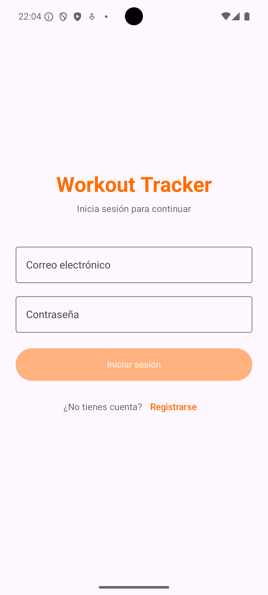
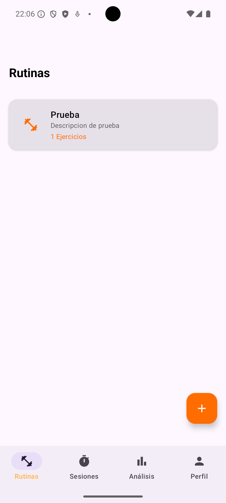
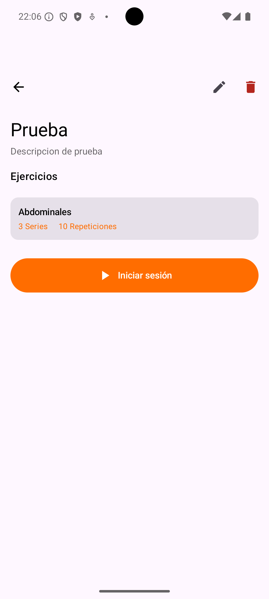
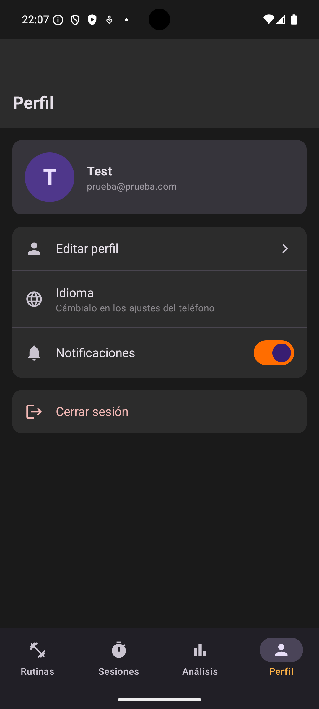
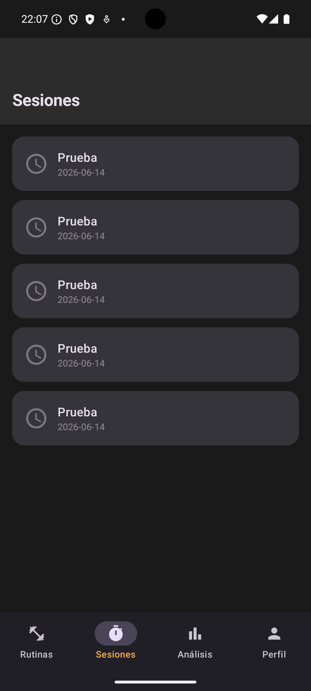
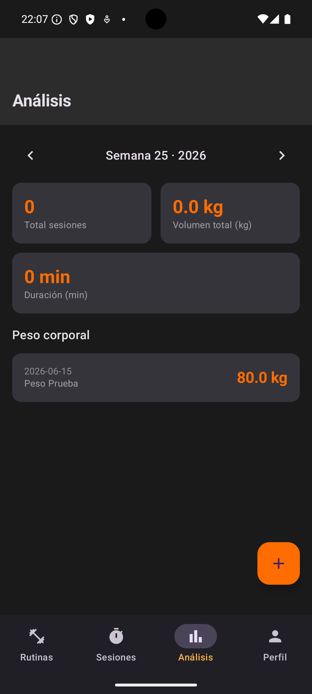

# Workout Tracker

An Android workout tracking app built as part of the CastroDev portfolio. Create and manage your workout routines, track your training sessions with exercise sets and reps, monitor your weekly analytics and body weight evolution.

---

## 📱 Screenshots

<p align="center">
  
  
  
  
</p>
<p align="center">
  
  
</p>

---

## ✨ Features

- 💪 **Routines** — Create and manage workout routines with custom exercises, sets, reps, weight and rest time
- ✏️ **Edit routines** — Update name, description and exercises at any time
- ▶️ **Sessions** — Start training sessions from a routine and complete them marking sets as done
- 📋 **Session history** — View all past completed sessions
- 📊 **Weekly analytics** — Total sessions, volume and duration per week with navigation between weeks
- ⚖️ **Body weight tracking** — Log your daily weight and track your evolution over time
- 🌙 **Dark mode** — Automatic dark/light mode based on system settings
- 👤 **Profile** — Edit name, manage notifications; language follows system settings
- 🌍 **Multilingual** — English and Spanish support

---

## 🛠️ Tech Stack

| Layer | Technology |
|---|---|
| Language | Kotlin |
| UI Framework | Jetpack Compose |
| State Management | ViewModel + StateFlow |
| Dependency Injection | Hilt |
| Authentication | Firebase Auth (Email) |
| Backend | .NET 10 REST API (Clean Architecture) |
| Database | Cloud Firestore (behind the API) |
| Networking | Retrofit + OkHttp |
| Logging | Timber |
| Testing | JUnit4, MockK, Turbine, coroutines-test |
| Infrastructure | Google Cloud Run |

---

## 🏗️ Architecture

The app follows **Clean Architecture** per feature. The presentation layer depends on domain abstractions only; Hilt wires the data implementations.

```
workouttracker/
├── core/
│   ├── network/       # API config, token provider, interceptor
│   ├── util/          # safeCall (Result + logging)
│   └── theme/         # Colors, typography, Material3 theme
├── di/                # Hilt modules (network, Firebase, bindings)
├── features/
│   ├── auth/          # Login, register
│   ├── routines/      # Routine CRUD with exercises
│   ├── sessions/      # Session tracking with set completion
│   ├── analytics/     # Weekly summary and body weight
│   ├── bodyweight/    # Body weight logging
│   └── profile/       # User profile & settings
└── navigation/        # App navigation & bottom tabs
```

Each feature follows the pattern:

```
Feature/
├── data/
│   ├── datasource/    # Retrofit API service & remote data source
│   ├── model/         # DTO models & request/response
│   └── repository/    # Repository implementations
├── domain/
│   ├── entity/        # Domain entities
│   ├── repository/    # Abstract repository interfaces
│   └── usecase/       # Business logic use cases
└── presentation/
    ├── screen/        # Composable screens
    ├── viewmodel/     # ViewModels with StateFlow
    └── components/    # Reusable UI components
```

---

## 🧭 Technical Decisions

- **Clean Architecture per feature.** Each feature has its own `data / domain / presentation`. The domain layer has no Android, Retrofit or Firebase code, so use cases and repository contracts can be tested on the JVM.
- **Hilt for dependency injection.** ViewModels receive their use cases through the constructor and never import the `data` package. Each repository interface is bound to its implementation in a single module (`BindingsModule`), so tests swap in fakes without touching production code.
- **ViewModel + StateFlow with sealed UI states.** Each screen exposes a `Loading / Success / Error` state, so the UI cannot show data that has not loaded.
- **`Result` with a `safeCall` helper instead of `runCatching`.** Repositories return `Result<T>` and log failures with Timber. `safeCall` re-throws `CancellationException`, which `runCatching` would swallow and turn into a failure when a coroutine is cancelled.
- **The domain owns its types.** Completing a session sends domain objects (`CompletedExercise`), and the data layer maps them to the API request. Before, the domain and the ViewModel imported request classes from `data`.
- **One Retrofit client, configured once.** A singleton OkHttp client adds the Firebase token through an interceptor. Request bodies are logged only in debug builds and the `Authorization` header is always redacted.
- **HTTP errors are not ignored.** Retrofit does not throw for `Response<Unit>` calls with an error status, so update, delete and complete calls check the response and fail explicitly.
- **Use cases per operation.** Most only delegate to the repository; creating a routine also validates the name before calling it.
- **Shared .NET 10 API.** Business rules live on the server and the app only talks to it with the user's Firebase token. One backend serves every app in this portfolio.
- **Tests with fakes, MockK and Turbine.** Use cases, repositories, remote data sources and ViewModels are covered with in-memory fakes of the domain interfaces. MockK is used where the collaborator is a concrete class or the Retrofit service.

### Other projects in this portfolio

| Project | Platform | Language |
|---|---|---|
| [finance-tracker](https://github.com/gcalvarez93/finance-tracker) | Flutter (iOS + Android) | Dart |
| [habit-tracker](https://github.com/gcalvarez93/habit-tracker) | Flutter (iOS + Android) | Dart |
| [task-manager](https://github.com/gcalvarez93/task-manager) | iOS | Swift |
| [budget-scanner](https://github.com/gcalvarez93/budget-scanner) | iOS | Swift |
| [recipe-manager](https://github.com/gcalvarez93/recipe-manager) | Android | Kotlin |
| [workout-tracker](https://github.com/gcalvarez93/workout-tracker) | Android | Kotlin |
| [castrodev-api](https://github.com/gcalvarez93/castrodev-api) | Shared backend | C# (.NET 10) |

---

## 🚀 Getting Started

### Prerequisites

- Android Studio Hedgehog or later
- Android SDK 26+
- Firebase project configured
- API running at `api.castrodev.com` or locally

### Installation

```bash
# Clone the repository
git clone https://github.com/gcalvarez93/workout-tracker.git

# Open in Android Studio
```

Then:

1. Add your `google-services.json` to the `app/` folder
2. Sync Gradle dependencies
3. Build and run with the Run button or `Shift + F10`

### Running Tests

```bash
./gradlew test
```

---

## 🔗 Related

- [CastroDev API](https://github.com/gcalvarez93/castrodev-api) — Shared .NET 10 backend

---

## 📄 License

MIT © Gabriel Castro

---

---

# Workout Tracker

App Android de seguimiento de entrenamientos desarrollada como parte del portfolio de CastroDev. Crea y gestiona tus rutinas de entrenamiento, registra tus sesiones con los ejercicios completados, y monitoriza tu progreso semanal y tu evolución de peso corporal.

---

## ✨ Funcionalidades

- 💪 **Rutinas** — Crea y gestiona rutinas con ejercicios personalizados, series, repeticiones, peso y tiempo de descanso
- ✏️ **Editar rutinas** — Actualiza nombre, descripción y ejercicios en cualquier momento
- ▶️ **Sesiones** — Inicia sesiones de entrenamiento desde una rutina y complétalas marcando las series
- 📋 **Historial de sesiones** — Consulta todas las sesiones completadas
- 📊 **Análisis semanal** — Total de sesiones, volumen y duración por semana con navegación entre semanas
- ⚖️ **Peso corporal** — Registra tu peso diario y sigue tu evolución en el tiempo
- 🌙 **Modo oscuro** — Modo oscuro/claro automático según la configuración del sistema
- 👤 **Perfil** — Edita tu nombre y gestiona notificaciones; el idioma sigue los ajustes del sistema
- 🌍 **Multiidioma** — Soporte para español e inglés

---

## 🛠️ Stack Tecnológico

| Capa | Tecnología |
|---|---|
| Lenguaje | Kotlin |
| UI Framework | Jetpack Compose |
| Estado | ViewModel + StateFlow |
| Inyección de dependencias | Hilt |
| Autenticación | Firebase Auth (Email) |
| Backend | API REST .NET 10 (Clean Architecture) |
| Base de datos | Cloud Firestore (tras la API) |
| Red | Retrofit + OkHttp |
| Logging | Timber |
| Testing | JUnit4, MockK, Turbine, coroutines-test |
| Infraestructura | Google Cloud Run |

---

## 🧭 Decisiones Técnicas

- **Clean Architecture por feature.** Cada feature tiene su propio `data / domain / presentation`. La capa de dominio no contiene código de Android, Retrofit ni Firebase, así que los casos de uso y los contratos de repositorio se prueban en la JVM.
- **Hilt para la inyección de dependencias.** Los ViewModels reciben sus casos de uso por constructor y nunca importan el paquete `data`. Cada interfaz de repositorio se enlaza con su implementación en un único módulo (`BindingsModule`), así que los tests sustituyen las implementaciones por fakes sin tocar el código de producción.
- **ViewModel + StateFlow con estados de UI sellados.** Cada pantalla expone un estado `Loading / Success / Error`, y la UI no puede mostrar datos que no se han cargado.
- **`Result` con un helper `safeCall` en lugar de `runCatching`.** Los repositorios devuelven `Result<T>` y registran los fallos con Timber. `safeCall` relanza `CancellationException`, que `runCatching` se tragaría y convertiría en fallo al cancelar una corrutina.
- **El dominio es dueño de sus tipos.** Al completar una sesión se envían objetos del dominio (`CompletedExercise`) y la capa data los traduce a la petición de la API. Antes, el dominio y el ViewModel importaban clases de petición desde `data`.
- **Un único cliente Retrofit, configurado una vez.** Un cliente OkHttp singleton añade el token de Firebase mediante un interceptor. El cuerpo de las peticiones solo se registra en builds de debug y la cabecera `Authorization` siempre se oculta.
- **Los errores HTTP no se ignoran.** Retrofit no lanza excepción en las llamadas `Response<Unit>` con estado de error, así que actualizar, borrar y completar comprueban la respuesta y fallan de forma explícita.
- **Casos de uso por operación.** La mayoría solo delega en el repositorio; crear una rutina también valida el nombre antes de llamarlo.
- **API compartida en .NET 10.** Las reglas de negocio viven en el servidor y la app solo habla con él usando el token de Firebase del usuario. Un solo backend sirve a todas las apps de este portfolio.
- **Tests con fakes, MockK y Turbine.** Casos de uso, repositorios, datasources remotos y ViewModels están cubiertos con fakes en memoria de las interfaces del dominio. MockK se usa cuando el colaborador es una clase concreta o el servicio Retrofit.

### Otros proyectos del portfolio

| Proyecto | Plataforma | Lenguaje |
|---|---|---|
| [finance-tracker](https://github.com/gcalvarez93/finance-tracker) | Flutter (iOS + Android) | Dart |
| [habit-tracker](https://github.com/gcalvarez93/habit-tracker) | Flutter (iOS + Android) | Dart |
| [task-manager](https://github.com/gcalvarez93/task-manager) | iOS | Swift |
| [budget-scanner](https://github.com/gcalvarez93/budget-scanner) | iOS | Swift |
| [recipe-manager](https://github.com/gcalvarez93/recipe-manager) | Android | Kotlin |
| [workout-tracker](https://github.com/gcalvarez93/workout-tracker) | Android | Kotlin |
| [castrodev-api](https://github.com/gcalvarez93/castrodev-api) | Backend compartido | C# (.NET 10) |

---

## 🚀 Instalación

### Requisitos previos

- Android Studio Hedgehog o posterior
- Android SDK 26+
- Proyecto Firebase configurado
- API disponible en `api.castrodev.com` o en local

### Pasos

```bash
# Clonar el repositorio
git clone https://github.com/gcalvarez93/workout-tracker.git

# Abrir en Android Studio
```

A continuación:

1. Añade tu `google-services.json` a la carpeta `app/`
2. Sincroniza las dependencias de Gradle
3. Compila y ejecuta con el botón Run o `Shift + F10`

### Tests

```bash
./gradlew test
```

---

## 🔗 Relacionado

- [CastroDev API](https://github.com/gcalvarez93/castrodev-api) — Backend compartido en .NET 10

---

## 📄 Licencia

MIT © Gabriel Castro
